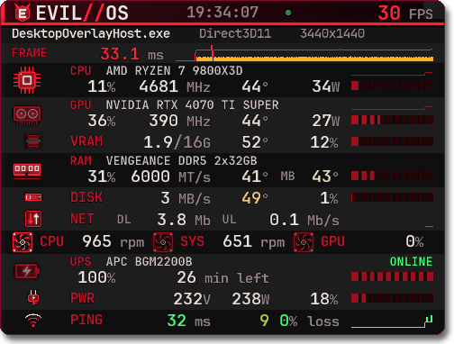
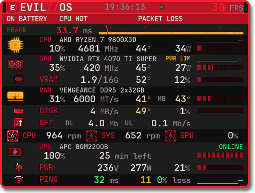

# EVIL//OS

A RivaTuner Statistics Server (RTSS) overlay in the [hackthecode](https://hackthecode.github.io) style: a dark panel with red accents and JetBrains Mono, drawn in the top-left corner of any game.



The panel shows real component names and live values:

- **FPS and frametime:** a frametime graph with amber spike bars.
- **CPU and GPU:** load, clock, temperature, power and a GPU limiter badge (`PWR LIM` / `TEMP LIM` / `VOLT LIM`).
- **Memory:** VRAM, and RAM speed and temperature.
- **Motherboard and disks:** motherboard temperature; disk throughput, the hottest drive and the busiest drive.
- **Network:** download and upload.
- **Fans:** CPU, system and GPU fans with animated icons.
- **APC UPS:** charge, runtime left, mains voltage, load in watts and %, and a blinking alarm when on battery. Read directly over USB HID.
- **Ping:** latency, jitter and packet loss, from its own ICMP pinger.

Values fade smoothly from white to amber to red as they rise. A small status dot in the header tells you whether the sensor bridge and HWiNFO are alive.

### Alerts

When something needs attention, a red band shows the alerts and the frame blinks:

- on battery;
- CPU/GPU too hot (the icon glows white-hot);
- packet loss;
- RAM almost full.



### Horizontal mode

Press **Scroll Lock** to switch between the vertical panel and a one-line bar across the top:


## How it works

```
HWiNFO64 ──shared memory──┐
APC UPS ──USB HID─────────┤                                          ┌─ EvilOS.ovl  (layout)
ICMP pinger ──────────────┼─> evilos_bridge.py ─MAHMSharedMemory─> RTSS OverlayEditor
                          │                                          └─ EvilOS.png  (icons + panel sprites)
RTSS HAL (CPU/GPU/RAM) ───┘
```

| File | What it does |
|---|---|
| `make_icons.py` | Draws the icon atlas `EvilOS.png`: component icons, 8 fan animation frames, hot/warn variants, status dots, segment mask. |
| `make_ovl.py` | Generates `EvilOS.ovl`: detects your CPU/GPU/RAM/UPS names, builds both layouts, and renders the panel background sprite (rounded corners, shadow, header gradient). |
| `evilos_bridge.py` | Background process (`pythonw`) that publishes UPS, HWiNFO and ping values to RTSS through the MSI Afterburner shared-memory format. No Afterburner needed. |
| `ups_hid.py` | Reads the APC Back-UPS HID reports (VID `051D`). |
| `hwinfo_shm.py` | Reads HWiNFO's sensor shared memory (no admin needed). |
| `hwinfo_watchdog.py` | Keeps HWiNFO's shared memory on: the free version turns it off after 12 h, so the watchdog restarts HWiNFO with `SensorsSM=1`. |
| `ping_stats.py` | ICMP pinger thread (`IcmpSendEcho`): latency, jitter and loss. |
| `preview.ps1`, `osd_dump.py` | Render a layout on the desktop, screenshot it and dump the hypertext RTSS draws, without starting a game. |

No LibreHardwareMonitor and no WinRing0 driver. All sensors come from HWiNFO, RTSS itself and the UPS.

## Install

Requirements: Windows 10/11, [RTSS](https://www.guru3d.com/download/rtss-rivatuner-statistics-server-download/) 7.3+, [HWiNFO64](https://www.hwinfo.com/), Python 3 with Pillow, and the JetBrains Mono Nerd Font.

```powershell
python make_icons.py
python make_ovl.py
```

Then:

1. Run `Install EvilOS Overlay.cmd` and accept the UAC prompt. It does three things:
   - copies the layout into RTSS;
   - enables the OverlayEditor and HotkeyHandler plugins;
   - registers autostart for RTSS, the bridge and the HWiNFO watchdog.
2. After changing the layout, run `update.ps1` as admin. It copies `EvilOS.ovl` and `EvilOS.png` again and restarts RTSS.

Paths like `C:\Python314` and the RTSS folder are set at the top of the PowerShell scripts. Change them if yours differ.

## Notes from building it

- The OverlayEditor source ships with RTSS in `SDK\Plugins\Client\OverlayEditor`. It is the only real documentation of the `.ovl` format.
- Formulas are validated once at load with every source set to `FLT_MAX`. A product such as `"a" * "b"` overflows and the formula is silently disabled forever, so combine conditions as `("a" > 0) * ("b" > 0)`.
- Never use the bare `<C>` colour pop in layer text. Inside games it pops to black.
